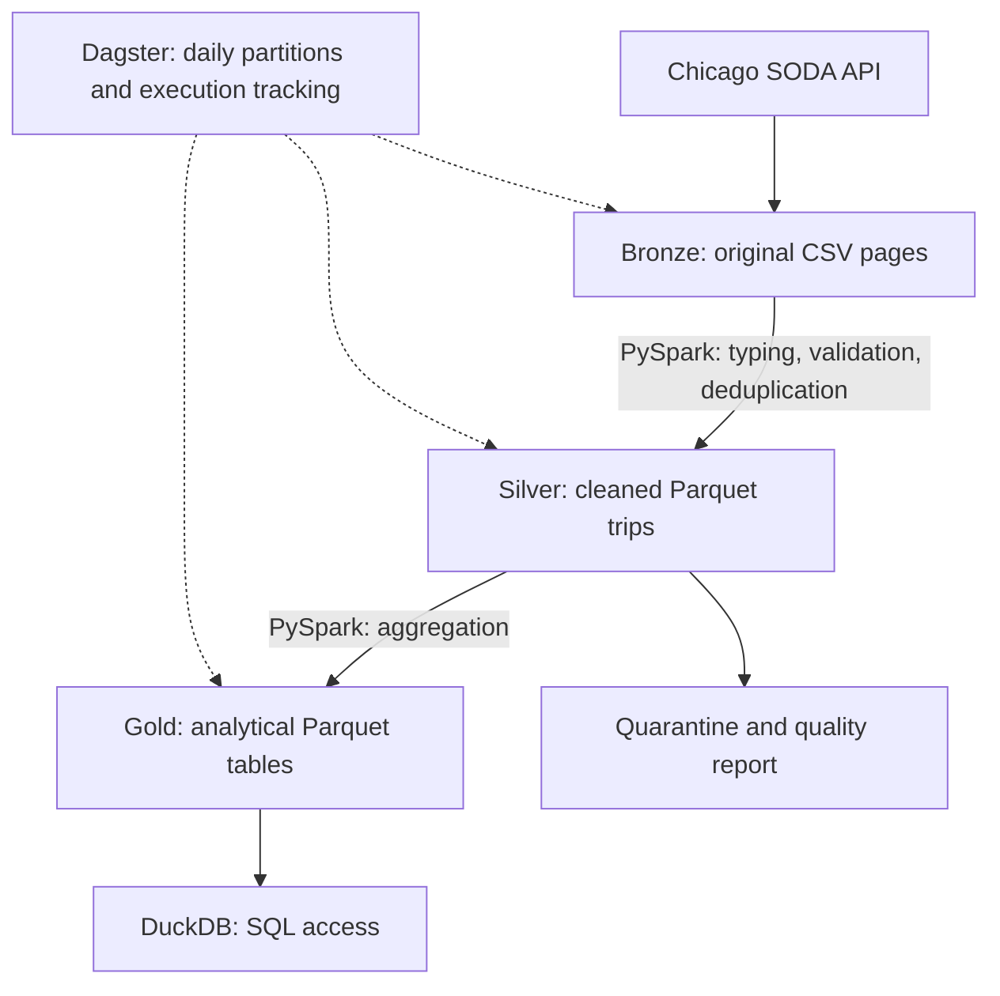

# Chicago Taxi Trips — Local Data Pipeline

An end-to-end medallion pipeline using Dagster, PySpark, S3-compatible object storage, and Docker Compose. It ingests taxi trips, cleans them, and exposes analytical tables through SQL.

## 1. Prerequisites and step-by-step launch

Requirements: Docker Desktop running with Linux containers (WSL 2 on Windows), Docker Compose v2, Internet access, approximately 16 GB of RAM, and several GB of free disk space. Python, Java, and Spark run inside Docker. No AWS account is needed.

Run all commands from the repository root (`test_technique_data_engineer_ma`).

**Step 1 — Build and start the services:**

```powershell
docker compose up --build -d
```

**Step 2 — Run the pipeline for the selected week:**

```powershell
docker compose exec dagster python -m taxi_pipeline.cli run --start 2023-01-01 --end 2023-01-08
```

The end date is exclusive. Each day is processed sequentially through Bronze, Silver, and Gold. For a shorter first run, use `--end 2023-01-02` to process January 1 only.

**Step 3 — Query Gold results:**

```powershell
docker compose exec dagster python -m taxi_pipeline.cli query --date 2023-01-01

docker compose exec dagster python -m taxi_pipeline.cli query --date 2023-01-01 --sql "SELECT rank, pickup_zone, trip_count FROM top_pickup_zones ORDER BY rank"
```

Dagster is available at http://localhost:3000 for asset dependencies, run history, and logs. To run from the UI, select all three assets, click Materialize, and choose a daily partition. No automatic schedule is enabled for this historical backfill.

Browse stored files at http://localhost:8888/buckets/chicago-taxi/ after ingestion.

**Check services, run tests, or stop the project:**

```powershell
docker compose ps
docker compose logs --tail 100 dagster
docker compose exec dagster python -m pytest -q
docker compose down
```

Stopping preserves Docker volumes. Ports bind to localhost. The local S3 credentials (`taxi_local` / `taxi_local_password`) are for development only.

### Dataset and reproducible download

Source: [Chicago Taxi Trips 2013–2023](https://data.cityofchicago.org/Transportation/Taxi-Trips-2013-2023-/wrvz-psew).

Selected period: **January 1–7, 2023 inclusive**. The observed snapshot contains **83,667 source rows**, keeping processing manageable on a laptop without truncating individual days.

`taxi_pipeline/ingestion.py` queries the SODA CSV API using a daily filter on `trip_start_timestamp`, an explicit column selection, `$limit=5000`, increasing `$offset` values, and ordering by `trip_start_timestamp,trip_id`. Each response is stored unchanged. Manifests record file locations, row counts, request parameters, and SHA-256 hashes.

To download Bronze alone through Dagster:

```powershell
docker compose exec dagster dagster asset materialize -m taxi_pipeline.definitions --select bronze --partition 2023-01-01
```

Optional `PAGE_SIZE` and `SODA_APP_TOKEN` settings can be supplied by copying `.env.example` to `.env`, then running `docker compose up -d`. To extend the period, update `PARTITIONS` in `definitions.py` and the requested date range. The provider may revise historical data; snapshots preserve the actual inputs used. Offset pagination assumes the source remains stable during download.

## 2. Architecture



All three layers, quarantine files, and manifests are persisted in **SeaweedFS**, an S3-compatible object store. Files are staged temporarily inside the processing container, and results are uploaded back to object storage. Dagster passes manifests between assets rather than Spark DataFrames.

Gold contains three tables:

| Table | Metrics |
|---|---|
| `daily_metrics` | Daily trip count, total revenue in USD, average duration in seconds, average distance in miles, and unknown pickup-zone count |
| `pickup_zones` | Trip count and revenue by day and pickup zone, including unknown zones |
| `top_pickup_zones` | Top ten known pickup zones per day by trip count, with ties broken by zone number |

## 3. Technical choices and tradeoffs

| Choice | Rationale and limitation |
|---|---|
| Dagster assets and daily partitions | Explicit dependencies, execution logs, and targeted reruns. Dates run sequentially to bound resource use. |
| Python ingestion and PySpark processing | Preserve raw CSV responses unchanged; use Spark for cleaning and aggregation. |
| Local Spark with temporary staging | Avoid a separate cluster and JVM S3 connector setup. Direct object-storage access would be preferable at larger scale. |
| SeaweedFS | Provide persistent S3-compatible storage locally without cloud resources. |
| Parquet and explicit types | Preserve analytical types; represent money as decimals. |
| Versioned snapshots and manifests | Publish completed versions and avoid double counting on reruns. Old snapshots require a retention policy. |
| DuckDB | Provide SQL access without another database service. Views are temporary and cover one date at a time. |

Spark runs in `local[2]` mode with a 1 GB driver heap and two shuffle partitions. Docker limits the processing container to 5 GB and storage to 1 GB. Avoid overlapping CLI and UI runs: publication does not protect against concurrent processing of the same date or provide transactions across layers.

### Quality rules and assumptions

Silver requires a nonempty trip ID, parseable timestamps, departure within the selected day, end not before start, positive duration, nonnegative distance, and nonnegative total amount. Valid rows are deduplicated by trip ID using deterministic ordering. Rejected rows remain in Bronze and are written to quarantine with their rejection reasons.

Missing or invalid community areas become unknown without rejecting the trip. Duration uses the declared `trip_seconds`, rather than the difference between rounded timestamps. Revenue is the sum of `trip_total`, not fare alone. Daily averages are calculated over individual accepted trips.

All KPIs use the same accepted trips. This excludes otherwise usable revenue when another required field is invalid. On January 1, rejected rows represented **2.46%** of inputs; duration filtering excluded **$4,804.03**, or **1.50%** of source revenue with valid nonnegative totals. These percentages describe that day only. Negative totals are treated as invalid; a business review would be needed to identify legitimate adjustments.

Silver checks parsed row counts against Bronze and reports accepted, rejected, and duplicate counts. Before Gold publication, daily counts and revenue are reconciled with Silver and all-zone totals. Empty input or no accepted trips causes failure. A failed run leaves the previous published Gold available.

### Local validation

Validated on October 28, 2026, using Windows, Docker Desktop, and WSL 2:

- **4 tests passed**, covering cleaning, deduplication, aggregation, pagination, and schema-error handling.
- Seven partitions completed: **83,667 source rows**, **81,952 accepted trips**, and **1,715 quarantined rows**.
- January 1 produced **10,779 accepted trips** and **$315,398.71** revenue; rerunning preserved the metrics without double counting.
- SQL queries and separate Silver/Gold CLI materializations succeeded.
- Recreating the storage container preserved the seven manifests and queried results.

## 4. What I would improve with more time

- Profile additional periods, agree on business quality thresholds, and consider validity rules per KPI.
- Add CI, fully locked dependencies and image digests, and failure-path tests for storage and publication.
- Add per-date concurrency protection, monitoring, alerts, and snapshot retention.
- Use direct Spark access to object storage and evaluate Iceberg or Delta for transactional tables.
- Add a zone dimension, multi-date SQL access, and a dashboard or persistent BI connection.
- Add authentication, TLS, and production deployment configuration.
